# Forge — Flow Diagrams

Companion to [`forge-architecture.md`](./forge-architecture.md). All main flows, rendered with Mermaid.

## 1. Component overview

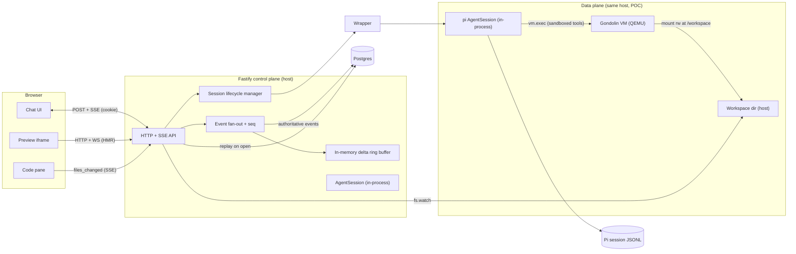

## 2. Session creation

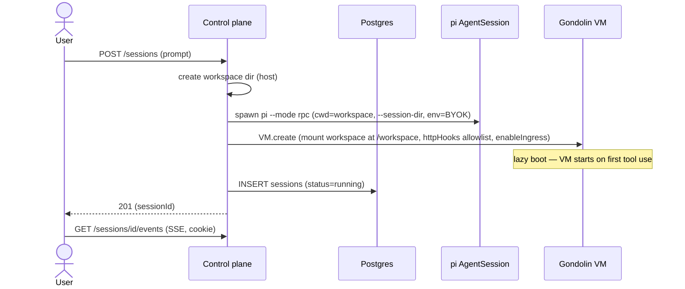

## 3. Chat turn (prompt / followUp / steer)

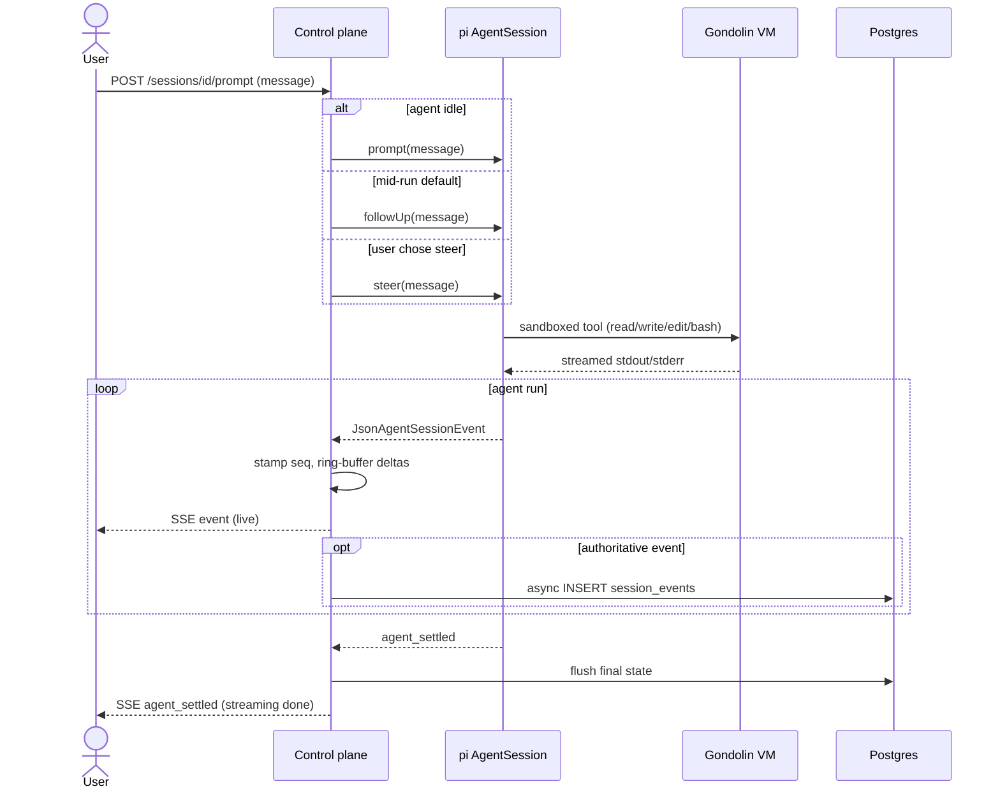

## 4. Reconnect / initial-open replay

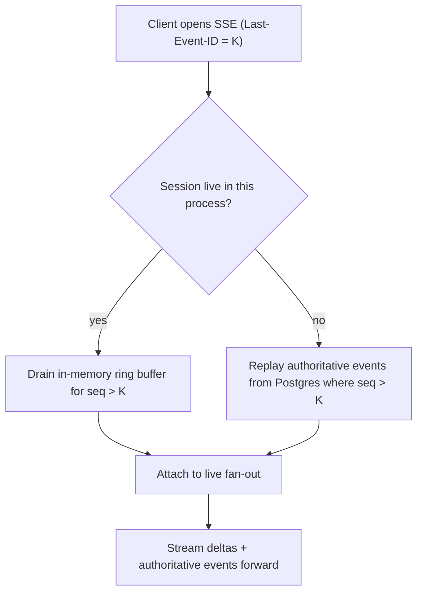

## 5. Preview lifecycle

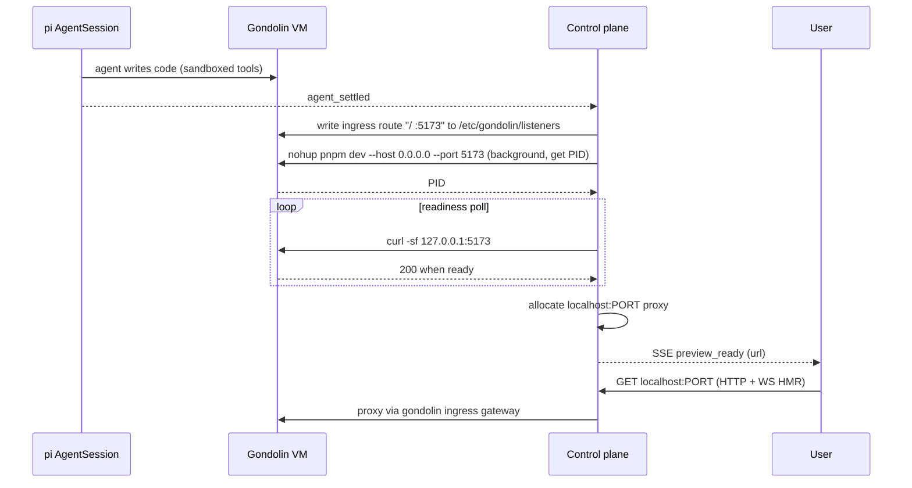

## 6. Resume a stopped session

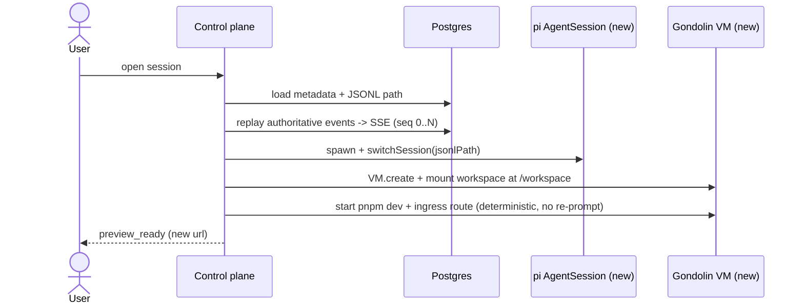

## 7. Teardown (non-destructive)

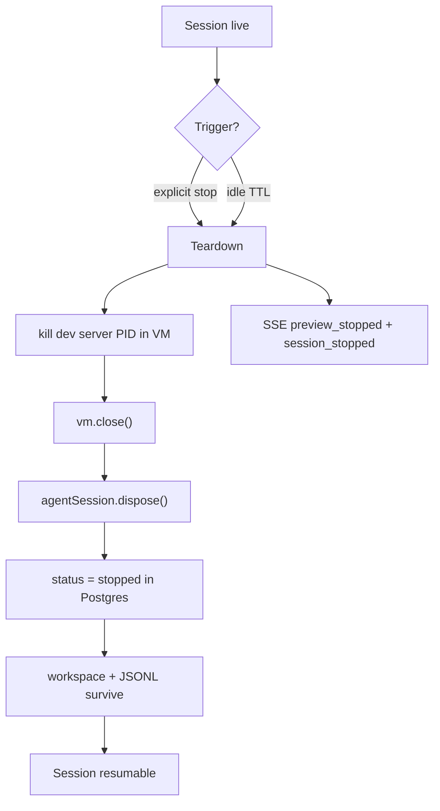

## 8. Failure modes

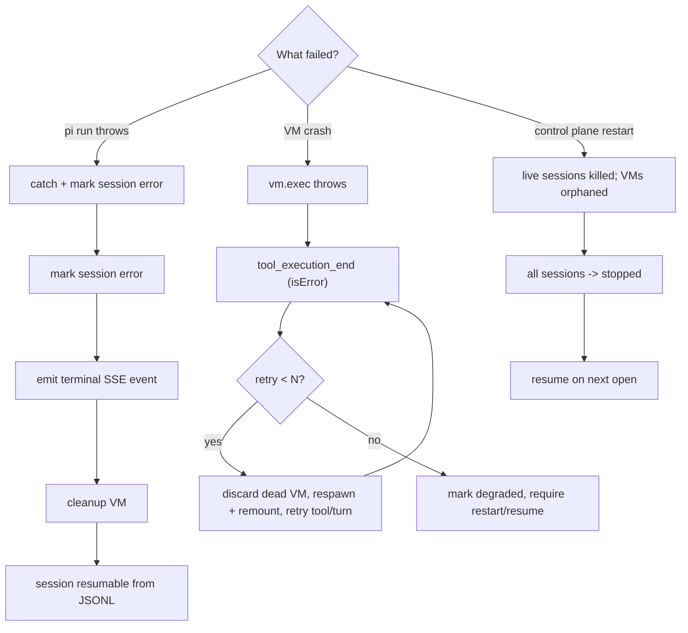

## 9. Persistence data flow

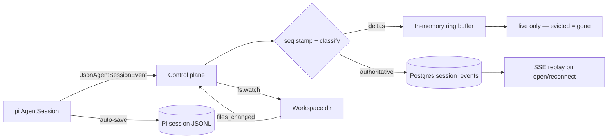

## 10. Session state machine

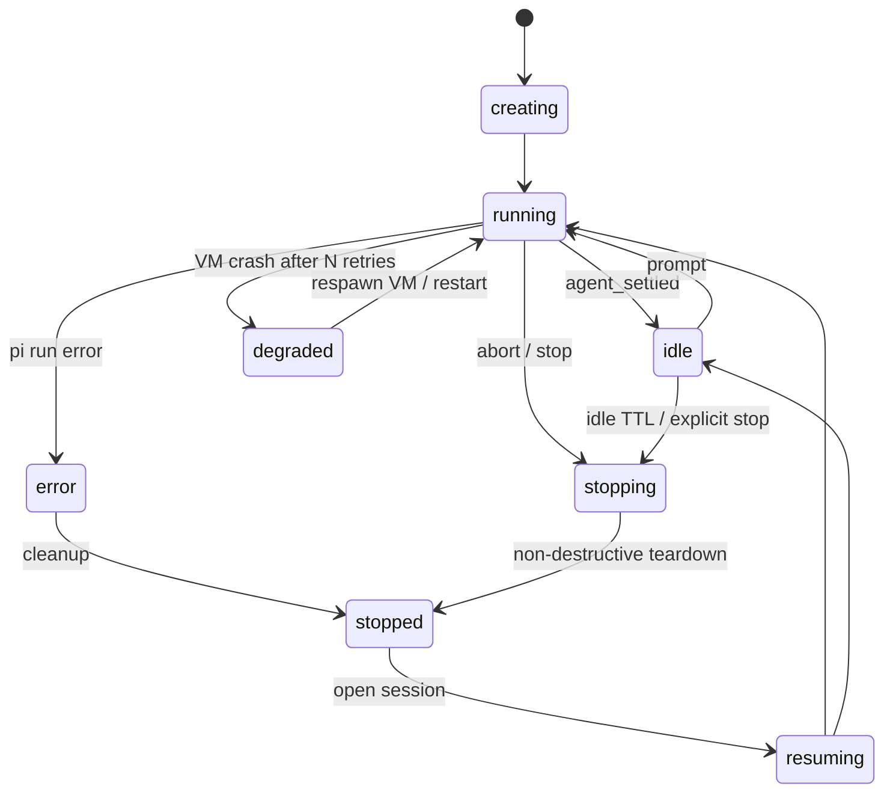

## 11. UI-only enforcement (soft, layered)

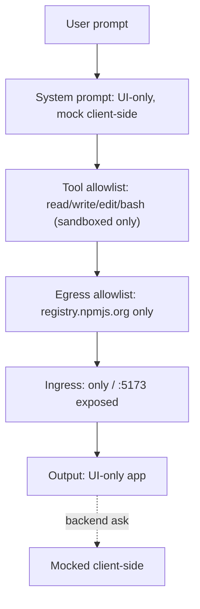
